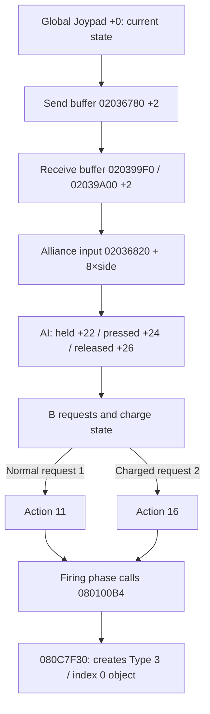

# Japanese Falzar: B input, charging, and attack-object creation

Audit date: 2026-10-10. Status: cross-version address matching and Ghidra analysis of 30 functions completed.
Original ROM functions were executed against controlled RAM states: all 1,388 checks passed,
with 554 snapshots archived. No actual battle was entered; collision and final HP loss remain unverified.

Baseline: `EXE_REVERSE_LOCAL_DIR/roms/exe6f.gba`,
SHA-1 `d1ce0ecc8e241a716274b9fb1b6eb07fb42dd166`.
The English reference is pinned to bn6f commit `d57c1968d27452de1042eff78b5dfbf124922666`.
Primary sources: `asm/asm01.s`, `asm/asm00_1.s`, `asm/asm00_2.s`, `asm/asm31.s`,
and `include/structs/AIData.inc`, `BattleObject.inc`, `NaviStats.inc`.

## Established path



Addresses in this diagram are hexadecimal. The send/receive path was confirmed from static code.
The non-network path at `0x08020280` copies the local send buffer into the receive buffer.
Transport handlers `0x0802032C` / `0x080203EA` pass received input to `0x0800A6BE`
and store the current global Joypad state in the send buffer.
Battle input therefore cannot be reduced to a direct read of global Joypad `+2` or `+4`;
the battle side uses the transported current state and recomputes edges.
Actual network transport, input latency, and synchronization between peers have not been dynamically verified.

## Key functions and addresses

| Purpose | English reference entry | Verified Japanese entry |
|---|---|---|
| Local input-buffer copy | `0x0801FE6C` | `0x08020280` |
| Input transport, two paths | `0x0801FF18` / `0x0801FFD6` | `0x0802032C` / `0x080203EA` |
| Write alliance input buffer | `0x0800A0D6` | `0x0800A6BE` |
| Convert buffer to player AI input | `0x08012DFC` | `0x080133FC` |
| Player update entry | `0x080EA484` | `0x080EFE14` |
| Input-request and charge-update wrapper | `0x08012E74` | `0x08013474` |
| Convert input to attack flags | `0x08012FC8` | `0x080135C8` |
| Update charge counter and state | `0x08012EBC` | `0x080134BC` |
| Charge-threshold lookup | `0x08012F62` | `0x08013562` |
| Consume requests and select action | `0x080F0354` | `0x080F5CEC` |
| Normal B attack initialization dispatch | `0x08011764` | `0x08011D74` |
| Charged B attack initialization dispatch | `0x080117A4` | `0x08011DB4` |
| Normal Buster initialization | `0x08011A26` | `0x08012036` |
| Charged Buster initialization | `0x08011A7E` | `0x0801208E` |
| Normal attack firing phase | `0x080EB450` | `0x080F0DE0` |
| Charged attack firing phase | `0x080EBE54` | `0x080F17F4` |
| Spawn attack object and calculate recovery time | `0x0800FAAC` | `0x080100B4` |
| Create Type 3 / index 0 object | `0x080C4FFE` | `0x080C7F30` |
| Basic attack-object initialization | `0x0801155A` | `0x08011B62` |

Full summaries and ranges are recorded in `../context/exe6f-battle-functions.json`
and `../context/exe6f-battle-ranges.tsv`.
The purpose labels above are research names assigned by this project, not official symbols.

The matching script `scripts/match-thumb-range.py` masks only Thumb-1 BL operands
and PC-relative LDR offsets; all other instruction bytes must match.
Actual call targets, literals, jump tables, and decompiled control flow were then checked.
A masked match alone does not prove behavioral equivalence.
The short normal/charged state dispatchers produced multiple signature candidates.
Their locations were resolved through the Japanese attack and phase jump tables,
rather than selecting the first candidate.

The Japanese attack jump table is at `0x080F05F0`: action `0x11` points to `0x080F0DC6`,
and action `0x16` to `0x080F17A0` (stored pointers include the Thumb bit).
Their phase tables point to the matched normal and charged firing phases.

## B input and charge fields

BattleObject `+0x58` holds the AI-data pointer. The input buffer contains two eight-byte
alliance entries, with current input at each entry's `+2`.
The writer computes pressed/released events at `+4` / `+6`.
Function `0x080133FC` recomputes the following fields against the player's previous AI input:

| AI offset | Meaning |
|---|---|
| `+0x06` | Normal B attack initialization-table index |
| `+0x07` | Charged B attack initialization-table index; `0xFF` disables it |
| `+0x1B` | Current charge counter |
| `+0x1D` | Charge state: 0 early, 1 intermediate, 2 fully charged |
| `+0x1E` | Current charge button: B is `2`, A is `1` |
| `+0x22` | Current held state |
| `+0x24` | Newly pressed events |
| `+0x26` | Released events, `previous & ~current` |
| `+0x28` | Previous held state; the reference name `JoypadReleased` can be misleading |
| `+0x44` | Behavior flags: normal request `1`, charged request `2`, B charging flag `0x40000` |
| `+0x48` | Eligibility/state flags; tests set `0x10` to satisfy charge eligibility |
| `+0xA0` onward | Attack parameters; damage is at AI `+0xA8` |

The tested standard MegaMan configuration uses `BButton=0` and `BPwrAtk=1`.
Holding B starts charging; releasing it triggers an attack.
A release with B as the charge button and charge state 2 produces request `2`;
otherwise it produces request `1`.
With `BPwrAtk=0xFF`, normal attacks instead read newly pressed events.
Some special BButton indices read held state, so release-triggered behavior must not be generalized to every form or ability.

The wrapper converts input into requests before updating the charge counter.
On release, request conversion reads the preceding update's charge state;
only afterward does the counter function clear the counter, state, and button.
Looking only at the cleared state would miss the charged-attack request already generated in that update.

B charge index 1 selects these thresholds from Japanese table `0x08020818`:

| Internal Charge value | 0 | 1 | 2 | 3 | 4 |
|---|---:|---:|---:|---:|---:|
| Updates required for full charge | 100 | 90 | 80 | 70 | 60 |

State is 0 below counter 10, becomes 1 at 10, and becomes 2 at the threshold, where the counter is clamped.
These values count function updates; pauses, time stops, and eligibility restrictions can affect elapsed time in an actual battle.

## Attack initialization and regional differences

`0x08011D74` dispatches by AI `+6`; `0x08011DB4` dispatches by AI `+7`.
Indices 0 / 1 in the shared Japanese initialization table at `0x08011DE4`
point to `0x08012036` / `0x0801208E`.
Normal initialization returns action `0x11`; charged initialization returns `0x16`.
The English symbol name `megamanChargeShotBPwrAtk_init_8011A26` alone therefore does not establish a charged path.

Controlled configuration: internal Attack=2, Charge=0, Transformation=0, Mood=1,
with relevant random Bug parameters disabled.
Actual initialization produced normal damage 3 and charged damage 30.
These are attack parameters; the resulting HP loss has not been established.

The first test zeroed all Navi stats. Mood=0 caused the emotion query to return 5,
so the normal-damage function took a branch returning a fixed value of 1.
After supplying the player index and setting Mood=1, normal damage returned to 3.
The final script also covers Mood=0: normal damage remains 1, while Japanese charged damage remains 30.

English charged initialization `[0x08011A7E,0x08011ADA)` is 92 bytes;
the Japanese function `[0x0801208E,0x080120DA)` is 76 bytes.
The Japanese version omits the English function's emotion query and special handling for result 5.
Its damage is calculated directly as `(internal Attack + 1) * 10`.
This is an actual code difference; a fixed address offset or English description cannot replace verification of the Japanese code.

## Evidence for attack-object creation

Both firing phases call `0x080100B4` when their local attack timer is 1.
That function places attack parameters in registers: type/parameters in `r4`,
initialized damage in `r6`, and additional flags in `r7`.
Function `0x080C7F30` then calls `object_spawnType3(0)`.
On success, `0x08011B62` writes position, alliance, associated player, and damage fields.

Both firing phases also call `0x080BAEC0` to create a temporary linked Type 1 / index 5 object.
Observing this temporary object alone does not establish the complete damage-bearing attack path.
This investigation separately traced Type 3 creation and damage-parameter transfer.
Object creation was confirmed statically; subsequent collision remains unverified.
These breakpoints have not been observed dynamically in an actual battle.

## Dynamic validation and reproduction

Script: `scripts/validate-battle-charge.py`.
Uses standard mGBA 0.10.2, a ROM copy, and the built-in BIOS, without loading personal saves or patching ROM instructions.
After the first main-loop breakpoint, it creates temporary object/AI data, Navi stats,
and a friendly-player index, then sets registers to call functions directly.
This uses synthetic RAM states and does not constitute an actual battle recording or end-to-end battle validation.

Executed original functions include the input-buffer writer, buffer-to-AI conversion,
attack requests, charge counter/threshold, and initialization dispatchers.
Every update first checks four AI input fields, then requests and charge state;
expected attack requests and charge results are not written directly into RAM.

| Test | State before release | Release request | Subsequent counter/state/button |
|---|---|---|---|
| Charge=0, held for 9 updates | 9 / state 0 | Normal `1` | 0 / 0 / 0 |
| Charge=0, held for 99 updates | 99 / state 1 | Normal `1` | 0 / 0 / 0 |
| Charge=0, held for 101 updates | Clamped to 100 / state 2 | Charged `2` | 0 / 0 / 0 |
| Charge=4, held for 61 updates | Clamped to 60 / state 2 | Charged `2` | 0 / 0 / 0 |
| BPwrAtk disabled, first B press | Charging not started | Normal `1`, triggered on press | Request only checked in this case |
| Eligibility flag absent, B held | 0 / state 0 | No request | 0 / 0 / 0 |

Both initialization dispatchers' action IDs and damage parameters at Mood=0/1 were also checked.
Final result: 1,388/1,388 checks passed, with 554 snapshots.

```bash
python3 scripts/validate-battle-charge.py --work-dir /tmp/exe6f-battle-check
```

The work directory must not already exist. The ROM, test save, and logs are written to that directory.
Static analysis uses `scripts/ghidra/AnalyzeThumbRanges.java` and the TSV range table above.
Use the same invocation as the first input function, replacing postScript with:

```text
-postScript AnalyzeThumbRanges.java /absolute/path/exe6f-battle-ranges.tsv /tmp/battle-static.txt
```

## Archived evidence and next steps

Paths relative to `EXE_REVERSE_LOCAL_DIR`:

- Ghidra project: `ghidra-projects/battle-buster-complete.gpr` and its matching `.rep/` directory.
- Raw records: `runs/2026-10-10-battle-buster/`.
- `snapshots.json` SHA-256: `9b70a9f3b3af5720a6f0d1c7423dc78d9ddaa43c080b53ca771192ada9b177bd`.
- `static-buster.txt` SHA-256: `63389fa6379c50f4f0f8e45c83a138eda1d6f5d9992c05fa10ca2bcea247d8d5`.
- `mapping.json` SHA-256: `0afc9c253c20b86ba6b18e6e64c905a91e2e6998c2a9536172f20aab7e3c6da0`.

Next, follow the Type 3 / index 0 object through updates, collision regions, final damage, and HP reduction.
The English candidate entry is `t3_0x0_80C4E58`; its Japanese address has not yet been matched.
Breakpoints in an actual Japanese Falzar battle are also needed to verify call counts,
pause conditions, input transport, and object lifetimes.
Cross, Beast, various Bugs, chip attacks, and PvP mechanics are outside the scope verified here.
