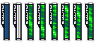
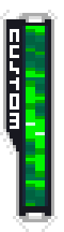

# Star Force 2 — Custom Gauge Tile Extraction and Layout Reconstruction

This document details the reverse engineering, loose tile decoding, and gauge assembly from the Japanese **Ryuusei no Rockman 2: Berserk x Shinobi** (Star Force 2) ROM. The ROM is not packaged.

- ROM SHA-256: `dfa8780c1f98059d466509e90004793ad89b87a7f9fce48210fca8ddc0ff3745`.
- Resource: `datbin/jpn/cockpit_local.bin` (uncompressed archive members).
- Member 5: frame/interior palette; member 6: green-ready palette.
- Member 19: white border, CUSTOM lettering, corners and repeating edge tiles.
- Member 21: white-to-blue interior tiles; tile 8 is the empty dark-blue background and tile 0 is the white charging progress.
- Member 23: three original green highlight tiles.
- Members 20 and 22: additional ready/L/R tiles, extracted as raw evidence.

## Tile Structure and Layout

These are raw 4bpp tile resources rather than an assembled sprite/animation container like SF3. The extraction tool decodes the original corners, lettering, and edge tiles, and composites a **20 × 72 frame** around a **56-pixel fill core** (8 × 56). Pixel colors and tile details are decoded bit-for-bit from the ROM.

The extracted assets comprise eight primary PNGs (exported to `exports/starforce/sf2/`):

- `WRGEMPTY`: 20 × 72 empty frame.
- `WRGFILL`: 8 × 56 white charging progress.
- `WRGRD00`–`WRGRD05`: six green full-gauge phases. Original tiles and both-axis flips form a 48-row pattern: 2, flipped 2, 0, 1, flipped 1, flipped 0. Each phase moves the pattern downward eight pixels. The first two phases match the reference captures [images/original-frame0.png](images/original-frame0.png) and [images/original-frame1.png](images/original-frame1.png) across their full 8 × 72 interior.

The ready phases represent a 6-phase looping animation (60 fps / four frames per image in the original engine). Six phases complete a cycle in 24 source frames.

## Extraction Tool

Run from the repository root:

```bash
python3 scripts/starforce/extract_starforce2_gauge.py \
  '/path/to/1722 - Ryuusei no RockMan 2 - Berserk x Shinobi (J)(Caravan).nds'
```

The script exports eight PNGs and a preview to `exports/starforce/sf2/`, with raw source members preserved in its `source/` subdirectory (`exports/` is ignored by git). `--output`, `--preview`, and `--raw-output` can override the destinations.

For Star Force 3 gauge extraction and technical details, see [Star Force 3 Custom Gauge](starforce3-custom-gauge.md).

## Visual References





## Validation

- SF2 textures regenerate byte-for-byte from the verified ROM SHA-256.
- The first two ready phases match original-game screenshots pixel-for-pixel across the entire interior.
- Border and interior tiles align seamlessly at 20 × 72 resolution.
