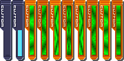
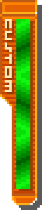

# Star Force 3 — Custom Gauge Sprite and Animation Extraction

This document details the reverse engineering, Nitro container decoding, and animated sprite extraction for the Custom Gauge from the Japanese **Ryuusei no Rockman 3: Red Joker (Rev 1)** ROM. The ROM itself is not packaged.

- ROM SHA-256: `0481662f341ebba0ef441492dd4965c15def441818a52bcd932c2a2d0e983cb4`
- Resource: `datbin/com/btl_cockpit_local.bin`, archive member **3** (LZ11 compressed).
- Decoded member SHA-256: `b347220c23a4ea362ee56d5d35f41537dbe23df40141f715e00b183dedb0f9a4`
- Ordinary border: sprite **0**, palette **0**.
- Ready animation: animation **1**, sprites **1–8**, each with duration **4**; palettes **1/2** alternate, and the sequence loops. The animated interior highlights are decoded from each sprite's own tile set.
- Fill: sprite **17**, the complete eight-row fill tile, sharing the same palette definitions.
- SF sprite layout interpretation was cross-checked against [BNSpriteEditor’s LoadSF reader](https://github.com/brianuuu/BNSpriteEditor/blob/main/bnsprite.cpp). The extraction script is implemented locally with Python's standard library.

## Data Structure and Layout

The game's native layouts and palette data are decoded directly from the ROM; no screenshot sampling or lossy palette conversion is used.

- The border and ready images use an 18 × 89 canvas focused on the vertical gauge body.
- `S3GEMPTY`: complete empty border and `CUSTOM` lettering (18 × 89).
- `S3GFILL`: contains only the full cyan interior fill (7 × 76). In playback, charging progress reveals 0–76 rows vertically from the bottom.
- `S3GRD00` through `S3GRD07`: use each original ready sprite and its recorded palette, cropped to the gauge body without L/R wings. Ready sprites include their own animated fill and highlights; subobjects are composited in stored order so the highlight layer remains visible.

### Animation Timing

The native animation sequence runs at 30 fps with a 4-frame duration per image (`duration = 4`, ~133.3 ms per frame). Across 8 distinct frames, a full loop lasts 32 animation ticks (~1.067s). The original pixel sequences and palette alternates (palettes 1 and 2) are preserved exactly as defined in the ROM animation table.

## Extraction Tool

Run from the repository root:

```bash
python3 scripts/starforce/extract_starforce3_gauge.py \
  '/path/to/Ryuusei no Rockman 3 - Red Joker (Japan) (Rev 1).nds'
```

The command writes 10 RGBA PNGs and an empty/half/eight-frame ready preview to `exports/starforce/sf3/`. Use `--output` and `--preview` to override destinations.

For Star Force 2 gauge extraction and loose tile reconstruction, see [Star Force 2 Custom Gauge](starforce2-custom-gauge.md).

## Visual References





## Validation

- All 10 PNGs regenerate byte-for-byte from the verified ROM SHA-256.
- The 19 sprites and 12 animations in archive member 3 match the confirmed layout fingerprint `(20, 19176, 19276, 19404, 1)`.
- The eight ready frames are distinct, decoding the exact subobject and tile combinations recorded in the animation table.
